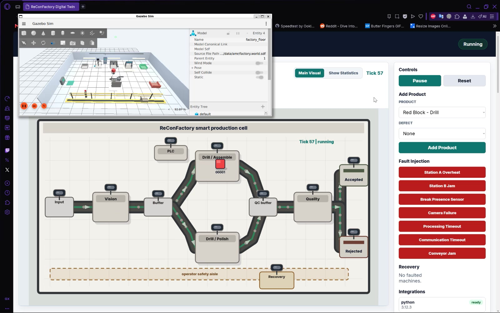

# Video gallery

[Open the complete overview](reconfactory-overview.mp4) · [Project README](../../README.md)

The 3:32 overview assembles eight screen recordings supplied by the project
author on 27 October 2026. All videos are silent H.264 MP4 at 1600×1000.
The individual clips preserve their supplied video streams and timing; their
MP4 containers are optimized for progressive playback. Any edits in the supplied
recordings are retained. The overview adds title/end cards and playback labels;
its first six chapters play at 2× supplied speed and its test chapters at 1×.
It is a presentation, not a continuous timing experiment.

## Overview chapters and individual recordings

| Overview start | Recording | Clip length |
|---|---|---:|
| 00:04 | [Normal production](01-normal-production.mp4) | 56.5 s |
| 00:32 | [Quality rejection](02-quality-rejection.mp4) | 63.5 s |
| 01:04 | [Fault-aware replanning](03-fault-replanning.mp4) | 63.8 s |
| 01:36 | [Charging and resumption](04-charging-and-resumption.mp4) | 66.1 s |
| 02:09 | [Predictive maintenance](05-predictive-maintenance.mp4) | 48.9 s |
| 02:33 | [Gate-crash protection and recovery](06-gate-crash-recovery.mp4) | 51.1 s |
| 02:59 | [Python and browser tests](07-python-browser-tests.mp4) | 18.4 s |
| 03:17 | [C++ watchdog tests](08-cpp-watchdog-tests.mp4) | 10.2 s |

Open an MP4 above and use GitHub's raw/download control if a player is not shown.
After cloning, the files can also be opened directly in a local video player.

## Reading the evidence

- Predictive maintenance selects compatible new work for B while A's telemetry
  is abnormal; A does not need to time out. Anomaly scores are not probabilities.
- Hard-fault replanning is a separate demonstration that cancels an invalid
  delivery and chooses a replacement destination.
- Charging uses an accelerated simulated energy model and logical payload
  attachment. This project does not implement physical grasping.
- The gate-crash clip includes the harness's final JSON result. Use its recorded
  measurements, not elapsed video playback, when describing stopping behavior.
- The Python clip shows 376 passing tests. The C++ report counts 25 result entries,
  including the wrapper for 24 policy cases; it is not 25 independent policy cases.
- These clips do not include a separate manager-crash recording. That scenario's
  measured verification remains in the technical documentation.

[Reproduction commands](../DEMO_SCENARIOS.md) ·
[Actuator watchdog](../ACTUATOR_DEADMAN_WATCHDOG.md) ·
[Latest GUI-load and outage verification](../ML_RECORDING_VERIFICATION_2026-10-27.md)
